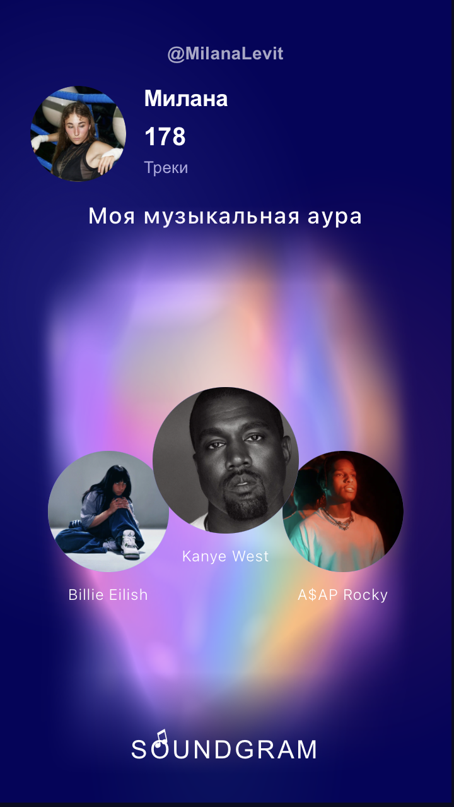
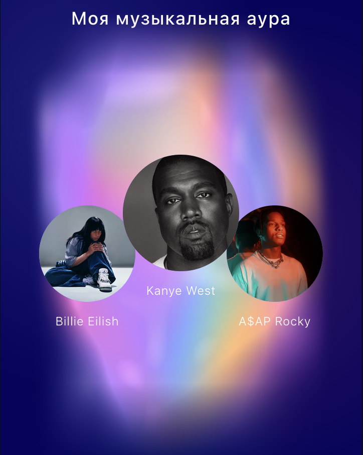
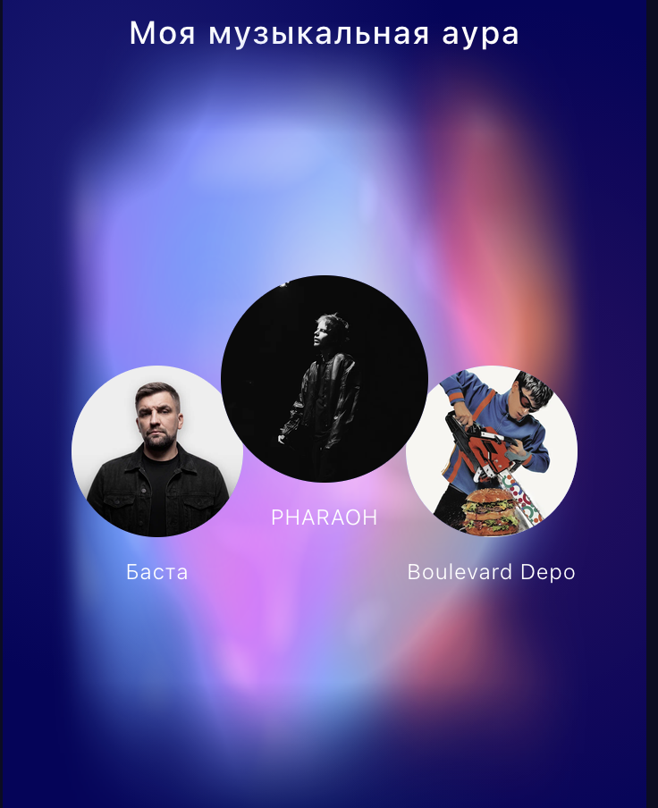
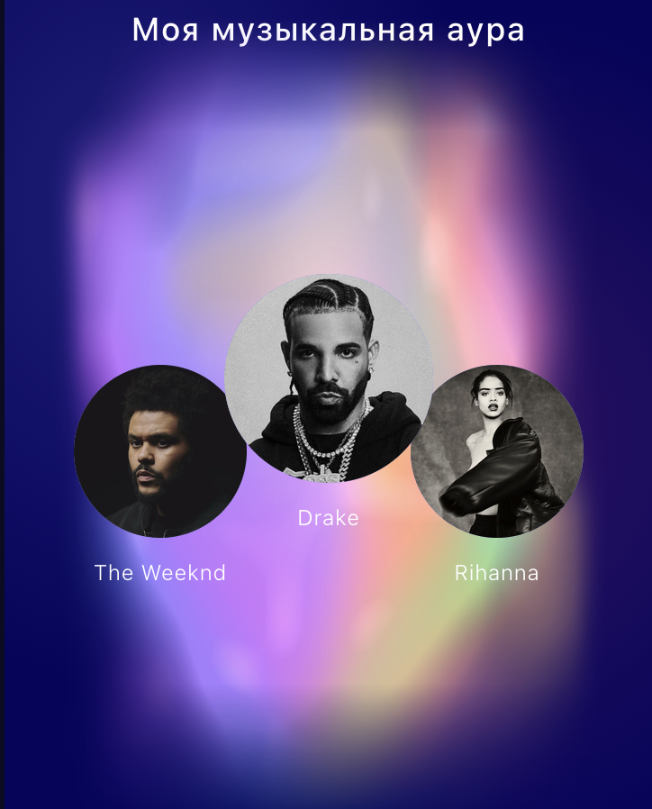

# SOUNDGRAM Stories

**Тестовое задание на позицию Frontend-разработчика в SOUNDGRAM.**

Telegram Mini App для создания музыкальной карточки и публикации её в Telegram Stories. Карточка показывает музыкальную ауру и трёх ведущих артистов; по нажатию «Поделиться в истории» приложение готовит PNG и открывает редактор Telegram Stories. Публикацию подтверждает сам пользователь.

**Ссылки:** [Telegram-бот](https://t.me/SoundGram_stories_test_bot) · [Демонстрация на Vercel](https://soundgram-stories.vercel.app) · [Исходный код](https://github.com/milanalevit-star/soundgram-stories)

> **Статус:** работающий тестовый прототип без интеграции с backend SOUNDGRAM. Имя, username и аватар берутся из Telegram; музыкальная аура и артисты — демонстрационные данные. Ссылка из истории открывает **тестовый экран с ID автора**, а не настоящий профиль в SOUNDGRAM.

## 1. Реализованные возможности

- Получение данных текущего пользователя из `Telegram.WebApp.initDataUnsafe.user` (имя, username, URL аватара).
- Карточка 9:16 с цветовой жанровой аурой, топ-3 артистов и брендингом SOUNDGRAM.
- Генерация PNG с помощью `html-to-image` и HTML Canvas API.
- Публикация через `Telegram.WebApp.shareToStory()` с изображением по публичному HTTPS-адресу.
- Ссылка из истории через `widget_link` и параметр `startapp=profile_<id>`.
- Заглушки при отсутствии фотографий, сокращение длинных имён, пустое состояние музыкальной библиотеки.
- Индикация подготовки истории и блокировка повторного нажатия во время обработки.

**Стек:** React, TypeScript, Vite, CSS, Canvas API, `html-to-image`, Telegram Mini Apps API, Cloudinary.

## 2. Запуск

Нужны Node.js (рекомендуется поддерживаемая LTS-версия) и npm.

```bash
git clone https://github.com/milanalevit-star/soundgram-stories.git
cd soundgram-stories
npm install
npm run dev
```

Vite покажет локальный адрес, обычно `http://localhost:5173/`. Если порт занят, он выберет следующий свободный.

Проверка production-сборки:

```bash
npm run build
```

### Запуск в Telegram

Mini App открывается по публичному HTTPS-адресу **https://soundgram-stories.vercel.app**. Он указан в настройках кнопки меню и основного Mini App бота через BotFather. Развёртывание на Vercel не требует запущенного локального сервера.

Для локальной отладки внутри Telegram можно временно использовать HTTPS-туннель (например, `ngrok http 5173`) и указать его адрес в настройках тестового бота. В итоговой версии **ngrok не используется**.

В обычном браузере нет пользовательского контекста Telegram и возможности вызвать редактор Telegram Stories. Браузер подходит для проверки вёрстки и экспорта, а полный сценарий необходимо проверять внутри Telegram.

## 3. Данные и допущения

Моки в `src/mockData.ts` соответствуют предоставленным контрактам:

```ts
type GenreAuraItem = {
  genre_id: string;
  name: string;
  share: number;
  tracks_count: number;
};
type GenreAuraResponse = { items: GenreAuraItem[] };

type TopArtistItem = {
  artist_id: string;
  name: string;
  tracks_count: number;
  image_url: string | null;
};
type TopArtistsResponse = { items: TopArtistItem[] };
```

В данных сохранены три набора: `me`, `eva` и `alya`. **В пользовательском интерфейсе отображается только основной набор `me`**; переключатель между профилями убран. Дополнительные наборы оставлены в коде для разработки и проверки разных распределений жанров. Это не данные реальных медиатек пользователей Telegram.

Имя, username и фотография принадлежат тому пользователю Telegram, который открыл приложение, но **аура, число треков и топ артистов сейчас одинаковые для разных пользователей**: они берутся из основного демонстрационного набора. Часть распределений жанров основана на значениях, просмотренных в интерфейсе SOUNDGRAM. Поскольку исходные отображаемые проценты не всегда составляли 100%, доли нормализованы до суммы 1. Некоторые значения `tracks_count` демонстрационные.

**Свежие треки.** По условию задания недавно добавленные треки должны сильнее влиять на жанровое распределение. Но контракт содержит уже агрегированное поле `share` и не передаёт даты добавления отдельных треков. Поэтому фронтенд не вычисляет временные веса: предполагается, что backend рассчитает взвешенные доли и отдаст готовый ответ.

**Артисты.** В карточке отображаются первые три артиста из мокового рейтинга. Для изображений используются внешние URL музыкального CDN, а не локальная папка с фотографиями.

## 4. Дизайн и концепция музыкальной ауры

### Основная идея

Цель дизайна — не просто показать музыкальную статистику пользователя, а превратить его музыкальные предпочтения в визуальный образ.

Мне хотелось, чтобы музыкальная аура стала своеобразным «отпечатком музыкального вкуса» человека.

В отличие от диаграмм и списков жанров, аура позволяет представить музыкальные предпочтения через сочетание цветов, их интенсивность и взаимодействие.

При этом визуализация не является случайным градиентом: её цветовая композиция формируется на основе музыкальных данных.

### Пример готовой музыкальной истории



Пример карточки с Telegram-профилем, музыкальной аурой, тремя ведущими артистами и брендингом SOUNDGRAM.

### Один жанр — один цвет

В основе моей концепции лежит идея постоянного соответствия музыкальных жанров определённым цветам.

Это означает, что один и тот же жанр должен отображаться одинаковым цветом у всех пользователей SOUNDGRAM.

Например, если два человека слушают один и тот же жанр, в их аурах будет присутствовать общий цвет. Однако итоговые композиции могут различаться из-за других жанров и их относительных долей.

Таким образом, цвет становится не только декоративным элементом, но и способом визуально передать музыкальные предпочтения.

В тестовом приложении эта идея реализована через таблицу соответствия жанров и цветов. Для неизвестных жанров предусмотрен запасной цвет.

В перспективе такую систему можно было бы использовать и в основном приложении SOUNDGRAM, чтобы сделать музыкальные портреты более персонализированными и узнаваемыми.

### Почему ауры пользователей отличаются

Внешний вид музыкальной ауры зависит от нескольких факторов:

- Набора музыкальных жанров в медиатеке.
- Доли каждого жанра.
- Соотношения ведущих жанров.
- Цветов, закреплённых за этими жанрами.

Если у пользователя преобладает определённый жанр, его цвет будет заметнее в общей композиции.

Если музыкальные предпочтения разнообразнее, аура будет содержать больше цветовых сочетаний.

Благодаря этому пользователи с разными музыкальными вкусами получают разные визуальные образы.

При этом одинаковые исходные данные могут создавать одинаковые ауры. Индивидуальность достигается за счёт музыкальных предпочтений, а не случайной генерации цветов.

### Примеры персонализации музыкальной ауры

Для демонстрации концепции использованы три тестовых набора музыкальных данных с разными жанровыми распределениями.

| Рэп и зарубежная музыка | Преобладание русского рэпа | Поп, рэп и R&B |
|:---:|:---:|:---:|
|  |  |  |

Все три ауры сформированы одним алгоритмом на разных тестовых наборах музыкальных данных. Цветовая композиция зависит от жанров и их относительных долей. В текущем прототипе музыкальные данные не привязаны к Telegram-пользователям; изображения демонстрируют принцип персонализации, который можно использовать при интеграции с backend SOUNDGRAM.

### Почему я выбрала именно такую форму

При разработке мне хотелось создать не просто визуализацию статистики, а образ, который ассоциировался бы с самой музыкой.

Поэтому вместо привычных диаграмм с чёткими границами я выбрала плавные, переплетающиеся цветовые потоки.

Такие формы напоминают движение, ритм и непрерывность звучания. Цвета не существуют отдельно друг от друга, а пересекаются и образуют единую композицию — так же, как разные жанры сочетаются в музыкальных предпочтениях человека.

Кроме того, мне хотелось, чтобы аура воспринималась не только как источник информации, но и как самостоятельный визуальный элемент, которым пользователю было бы интересно поделиться.

При этом интенсивность цветовых потоков зависит от долей соответствующих жанров.

Для сохранения читаемости в визуализации используются **до восьми ведущих жанров**. Это позволяет избежать чрезмерного смешения цветов, особенно если музыкальная медиатека пользователя очень разнообразна.

### Почему именно такой дизайн Stories

Карточка разрабатывалась специально для вертикального формата **9:16**.

Я учитывала, что Telegram Stories обычно просматривают быстро, поэтому зрителю должно быть достаточно нескольких секунд, чтобы понять, кому принадлежит музыкальный портрет и что именно он показывает.

Для этого информация распределена по визуальной иерархии:

1. **Верхняя часть — информация о пользователе.**

   Аватар, имя и username позволяют сразу понять, кому принадлежит музыкальная аура.

2. **Центральная часть — музыкальная аура.**

   Это главный визуальный акцент карточки. Она привлекает внимание цветом и формой.

3. **Топ-3 артиста — связь с реальной музыкой.**

   Фотографии и имена любимых исполнителей помогают зрителю быстрее понять музыкальные предпочтения человека. Они дополняют абстрактную цветовую визуализацию конкретной информацией.

4. **Нижняя часть — SOUNDGRAM.**

   Название проекта показывает, где был создан музыкальный портрет.

Мне было важно сохранить баланс между визуальной выразительностью и количеством информации. Поэтому карточка не перегружена дополнительными показателями и текстом.

Предполагается, что такая композиция будет понятна с первых секунд просмотра. При этом скорость восприятия пока не проверялась отдельным пользовательским исследованием.

### Связь с айдентикой SOUNDGRAM

При разработке я ориентировалась на существующую визуальную стилистику SOUNDGRAM: тёмный фон, яркие цветовые акценты, музыкальную тематику и внимание к личности пользователя.

Тёмный фон помогает выделить цветовые потоки ауры и фотографии артистов, не отвлекая внимание на второстепенные элементы.

При этом композиция не повторяет существующий экран музыкального портрета буквально, а адаптирует его идею под формат Telegram Stories.

Мне хотелось сохранить узнаваемость SOUNDGRAM, но сделать карточку самостоятельным изображением, которое органично смотрелось бы среди других историй Telegram.

### Возможное развитие концепции в SOUNDGRAM

В качестве возможного развития музыкального портрета SOUNDGRAM я предлагаю рассмотреть систему постоянных жанровых цветов. Она позволит связывать визуальный образ пользователя с его музыкальными предпочтениями и формировать разные цветовые композиции на основе жанрового распределения.

В таком случае музыкальная аура могла бы стать не просто декоративным элементом, а визуальным отражением индивидуальных музыкальных предпочтений.

Это открывает несколько интересных возможностей:

- **Визуальное сравнение музыкальных вкусов.** Пользователи могли бы замечать сходство своих аур и находить общие музыкальные предпочтения.
- **Узнаваемый цветовой язык жанров.** Определённые цвета постепенно могли бы ассоциироваться с конкретными музыкальными направлениями.
- **Персонализация профиля.** Аура могла бы стать одним из узнаваемых визуальных элементов пользователя.
- **Публикация в социальных сетях.** Индивидуальный музыкальный портрет мог бы мотивировать пользователей делиться своими предпочтениями.

В текущем прототипе концепция продемонстрирована на моковых музыкальных данных. Для полноценной интеграции потребуются реальные данные SOUNDGRAM и согласованная система соответствия жанров и цветов.

## 5. Генерация PNG и открытие Telegram Stories

1. `StoryCard` отрисовывает карточку средствами React, HTML и CSS.
2. `html-to-image` создаёт базовый слой изображения из DOM.
3. Отдельный Canvas объединяет базовый слой, жанровую ауру, Telegram-аватар, фотографии или заглушки артистов и подписи.
4. PNG загружается в Cloudinary, который возвращает публичный HTTPS-URL.
5. `Telegram.WebApp.shareToStory(url, options)` открывает редактор Telegram Stories с готовым изображением и ссылкой на тестовый профиль. **Приложение не публикует историю без подтверждения пользователя.**

API `shareToStory()` ожидает доступный Telegram URL изображения; локальный `data:`/`blob:`-адрес нельзя использовать как замену публичному URL в этом сценарии.

**Почему комбинированный экспорт:** чистый DOM-экспорт проще, но внешние изображения, CORS и Canvas-слои создают ограничения. Полная ручная отрисовка Canvas даёт больше контроля, но усложняет вёрстку. Выбранный подход сочетает HTML/CSS для интерфейса и Canvas для точной композиции графических слоёв.

**Кнопка «Скачать PNG»** не входит в итоговый интерфейс Mini App: её поведение внутри Telegram WebView оказалось ненадёжным. Внутренняя генерация PNG для `shareToStory()` при этом сохранена.

## 6. Переход зрителя из истории

При открытии редактора приложение передаёт `widget_link` с адресом вида:

```text
https://t.me/SoundGram_stories_test_bot?startapp=profile_<telegram_user_id>
```

Получив `Telegram.WebApp.initDataUnsafe.start_param`, тестовое Mini App извлекает ID автора и показывает **демонстрационный экран профиля** с этим идентификатором. Переход **из уже опубликованной истории со второго Telegram-аккаунта** проверен на iPhone.

Кнопка «Вернуться к моей ауре» открывает основной экран приложения **для зрителя**: там отображаются его имя и аватар Telegram, но общий моковый музыкальный набор `me`. Это **не** музыкальная аура автора истории и не реальная медиатека зрителя.

Для интеграции с настоящим SOUNDGRAM необходимы подтверждённый формат продуктового deep link, код профиля от backend и загрузка профиля автора по этому коду. Telegram ID нельзя автоматически считать идентификатором профиля SOUNDGRAM. В прототипе такой интеграции нет.

## 7. Внешние изображения, CORS и безопасность

**Telegram-аватар.** URL из `initDataUnsafe.user.photo_url` может отображаться в ``, но не разрешать чтение пикселей в Canvas из-за CORS (`The operation is insecure`). В прототипе изображение по URL подготавливается через Cloudinary и затем загружается для Canvas. Если Telegram-аватар отсутствует, в интерфейсе используется первая буква имени.

**Артисты.** Фотографии поступают с внешнего музыкального CDN. При отсутствии фотографии предусмотрена заглушка с инициалом. При экспорте сложные графические элементы рисуются отдельно для контроля наложения и CORS.

**Ограничение безопасности.** В демонстрационном варианте используется unsigned upload в Cloudinary с настройками, доступными в клиентском коде. Это не безопасная схема для production: публичным сервисом загрузки могут злоупотреблять, а пользовательские аватары и PNG доступны по публичным URL. Для рабочего продукта нужны проверка Telegram `initData` на сервере, аутентифицированная загрузка, ограничения типов и размеров файлов, rate limiting, политика хранения/удаления и учёт прав на изображения. Токены бота и API-secret не должны публиковаться во frontend или GitHub.

## 8. Шрифты и совпадение интерфейса с PNG

В интерфейсе стили задаются CSS. При экспорте имена артистов отрисовываются вручную через Canvas с контролем цвета, ширины и сокращения длинных подписей многоточием. Возможны небольшие различия в отображении шрифтов на разных платформах.

Во время разработки была обнаружена ошибка: в одном из ранних экспортов имена артистов становились чёрными вместо белых. Цвет был явно задан при отрисовке Canvas; исправленная публикация **проверена на iPhone**.

## 9. Проверенные платформы и ограничения

| Платформа | Проверка | Результат |
| --- | --- | --- |
| **Telegram на iPhone** | Mini App → редактор → публикация → просмотр со второго аккаунта → переход | **Проверено:** виджет ссылки отображается, тестовый профиль открывается без ngrok |
| **Telegram Desktop (macOS)** | Открытие Mini App и редактора Stories | Проверено; в испытанной версии клиента автоматический виджет ссылки не появился |
| **Android** | Практическое тестирование | Не проводилось |
| **Telegram Web** | Практическое тестирование | Не проводилось |
| **Обычный браузер** | Вёрстка, локальная отладка | Работает без Telegram-контекста; открытие редактора Stories недоступно |

Перед публикацией проверяется требуемая версия Telegram Mini Apps API; при недостаточной версии приложение сообщает о необходимости обновления. Реальная возможность публикации зависит также от клиента и ограничений Telegram/аккаунта, включая возможные ограничения Premium. Полноценный fallback для клиентов без `shareToStory()` в прототипе **не реализован**; потенциальное развитие — надёжный экспорт PNG и инструкция для ручной публикации.

## 10. Производительность

Измеренное время от нажатия «Поделиться в истории» до редактора Telegram Stories: **10,08 с; 8,25 с; 7,86 с** (среднее **≈ 8,73 с**). После обновления страницы первый запуск иногда занимал до **15 с**.

| Этап | Замер 1 | Замер 2 |
| --- | ---: | ---: |
| Подготовка аватара | 1,54 с | 2,04 с |
| Генерация PNG | 0,53 с | 0,48 с |
| Загрузка PNG | 3,12 с | 2,63 с |
| **Сумма измеренных этапов** | **5,19 с** | **5,15 с** |

Суммы этапов **не равны** общему времени до редактора: остальные задержки зависят от среды, сетевого обмена и открытия Telegram Stories. Значительная часть измеренного времени связана с загрузкой изображений. Во время обработки кнопка показывает «Подготавливаем историю…» и защищена от повторного нажатия.

Дальнейшая оптимизация: кеширование аватара, уменьшение числа сетевых операций и повторное использование уже подготовленного PNG. На слабом Android-устройстве замеры не проводились.

## 11. Краевые случаи

| Сценарий | Поведение | Проверка |
| --- | --- | --- |
| Нет Telegram-аватара | Круг с первой буквой имени | Проверено |
| Отсутствует изображение артиста | Круг с инициалом | Проверено в интерфейсе и локальном PNG |
| Один жанр | Аура из одного цветового потока | Проверено |
| 20 жанров | Отображается до восьми ведущих | Проверено |
| Длинное имя или username | Ограничение ширины текста | Проверено визуально |
| Длинное имя артиста | Сокращение с многоточием | Проверено |
| Пустой музыкальный профиль | Пустое состояние и недоступная публикация | Проверено |
| Неизвестный жанр | Запасной цвет | Предусмотрено кодом |
| Нет фамилии или username | Необязательные данные не блокируют карточку | Предусмотрено кодом |
| Меньше трёх артистов | Отображаются доступные | Предусмотрено кодом |

Не все сетевые ошибки и комбинации краевых случаев были проверены на всех платформах.

## 12. Ограничения и развитие

- Музыкальные данные и рейтинги артистов — моки; backend SOUNDGRAM не подключён.
- Ссылка из истории ведёт на тестовый экран с Telegram ID автора, не в реальный профиль SOUNDGRAM.
- Обработка аватаров и публичных PNG через Cloudinary требует защищённой серверной реализации перед production.
- Внешние CDN могут менять доступность и условия использования; права на изображения необходимо учитывать.
- Платформенные ограничения Telegram Stories, включая различия между Desktop и iPhone, требуют дополнительного тестирования.
- Android, Telegram Web и слабые устройства пока не протестированы.
- Нет полноценного запасного сценария публикации без поддержки `shareToStory()`; сетевые сбои также требуют более полной обработки и повторных попыток.

## 13. Видеодемонстрация

Записаны два отдельных видео, демонстрирующие основные сценарии работы приложения.

1. [Создание и публикация истории](demo/01-create-story.MP4) — запуск Mini App, подготовка изображения, открытие редактора и публикация Telegram Stories.
2. [Переход из опубликованной истории](demo/02-open-profile.MP4) — просмотр истории со второго аккаунта и переход по виджету в демонстрационный профиль автора.